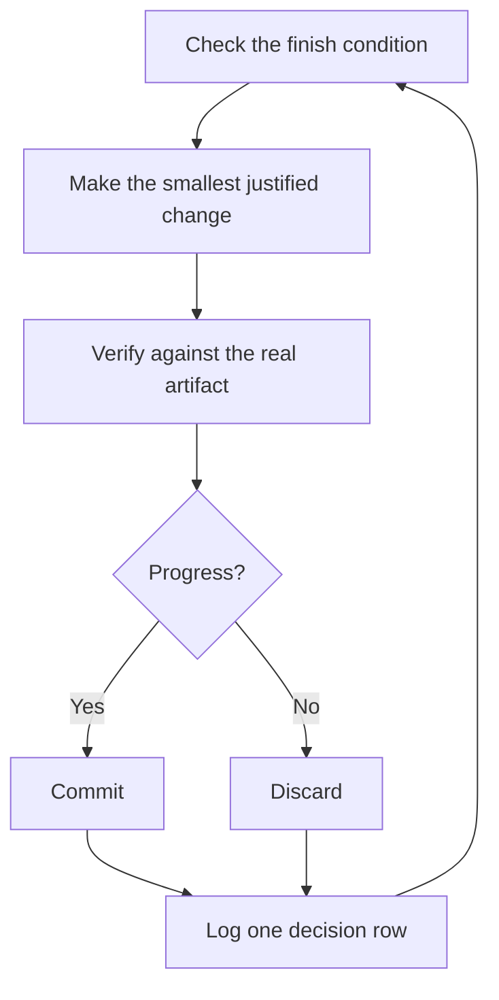

# Run work while you sleep

This is the payoff for everything before it. An agent you can trust to verify its own work is an agent you can leave alone with a hard task. What makes that safe isn't hope. It's a checkable finish condition, isolated workspaces (`Workspace: "share"` / git worktrees), Antigravity's native **`/goal`** and **`/swarm`**, and a decision log you audit in the morning.


## Earn the trust before the loop

A loop you don't trust just produces unchecked work faster, and the mess compounds with every iteration. Before you leave one running, check that it has earned it:

- You've done the task once by hand, or watched an agent do it, so you know what good looks like.
- The agent has the tools and signals you'd use yourself: the verification skill, the profiler, the logs.
- Every stage proves its work and can stop the line when the work misses the bar.
- You've read a few transcripts and turned the repeated failures into tools, skills, or checks.

Make the loop autonomous only after all four hold. Until then, run it while you watch.

## The overnight contract

A good handoff has the goal, the finish condition, permissions, and an escape hatch. It doesn't need to be long:

```text
/goal /poteto-mode im going to bed. migrate every caller to the new parser in a fresh worktree off <base>.
done means zero old callers, all parser fixtures pass, old api deleted.
keep a decision log. don't ask me before committing.
if you're truly stuck after a few hours, stop and write up why.
```

Walk through what each line buys you:

- **`/goal`** is Antigravity's native slash command for long-running autonomous execution that won't stop until the goal is achieved.
- **"im going to bed"** is a session override so the agent stops asking on reversible steps and keeps going.
- **"done means..."** turns the goal into checks every iteration can run.
- **"fresh worktree off `<base>`"** keeps the run from colliding with anything else you have open.
- **"don't ask me before committing"** pre-answers the permission the agent would otherwise block on.
- The [Autonomous run playbook](../../skills/poteto-mode/playbooks/autonomous-run.md) uses Antigravity's native **`schedule`** tool (`DurationSeconds` / `CronExpression`) and reactive background tasks to wake on events or heartbeats.
- The escape hatch lets it stop at a genuine dead end and write up why, which beats eight hours of creative goal reinterpretation.

Because you'll review this work after stepping away, `/poteto-mode` routes it through [`/figure-it-out`](../../skills/figure-it-out/SKILL.md), which designs the run's phases before any code and wires in the decision log.

To stop a run on purpose, tell the agent to pause. The [Pause safely playbook](../../skills/poteto-mode/playbooks/pause-safely.md) finishes or backs out of the current step, commits a work-in-progress checkpoint, and writes a resume note. A fresh conversation picks the work up from that note through the Session pickup playbook. Saying "keep going" never triggers a pause.

## What the loop does all night



One change, one check, one log row, every iteration. Changes that didn't help get discarded, not left to ride. A plateau means pivot, not stop, and the finish condition never quietly relaxes to declare victory.

## The morning audit

[`/show-me-your-work`](../../skills/show-me-your-work/SKILL.md) is what makes the run reviewable. Each row records the time, phase, decision, reason, an evidence pointer, and the result, in a TSV at `decisions.tsv` (or `.audit/<task-slug>.tsv` when several runs share a directory). It stays local by default. Commit it when the work is ambitious enough that a reviewer needs the trail to trust the result.

When you're back, ask for the run in review form:

```text
/show-me-your-work catch me up on what you did last night
```

Before the skill hands back its summary, it runs an independent reviewer (`research` subagent or distinct `/swarm` model) over the trail and Antigravity's `transcript.jsonl`, and the reply ends with an **Attention** section listing what deserves your scrutiny. Read that section first, then the log rows it points at. You're auditing decisions, not re-reading the whole night.

For a quick status instead of an audit, run [`/ketchup`](../../skills/ketchup/SKILL.md) in the chat that ran the work. It reads only, and tells you in plain words what changed since your last message, with screenshots and small diagrams, followed by every call waiting on you.

## When the night holds a queue, not a task

The contract above drives one task to one finish condition. Some nights hold more — a queue of independent changes or a whole program. Two playbooks scale the same trust up using Antigravity's native **`/swarm`**:

[Autopilot-full](../../skills/poteto-mode/playbooks/autopilot-full.md) runs a queue of independent PRs to merged. Each PR gets one `/swarm` owner worker in its own `workspace: "share"` checkout, and no owner merges on its own verdict. Independent verifier workers on the shared board prove the code-ready head. Only a clean verdict on the patch that merges authorizes the merge:

```text
/goal /poteto-mode full autopilot on this queue. each item is independent. i want them merged by morning.
```

[Autopilot-stack](../../skills/poteto-mode/playbooks/autopilot-stack.md) is Autopilot-full without the merge. You wake up to verified PRs, each with its verdict, and you review and land them yourself:

```text
/goal /poteto-mode autopilot these five changes, but don't merge. i'll land them in the morning.
```

A whole program, such as a migration across many packages, routes through [`/figure-it-out`](../../skills/figure-it-out/SKILL.md):

```text
/poteto-mode migrate every package to the new store. own it until each one is converted and merged. i'll check in twice a day.
```

## Coordinate parallel teams with native `/swarm` and `/teamwork`

Antigravity's native **`/swarm`** gives you a coordinator thread backed by a shared message board, isolated `workspace: "share"` checkouts per author, dedicated verifiers, a live UI board, and an automatic stall monitor. Start your prompt with `/poteto-mode` and let the coordinator direct workers: every worker reads [`worker.md`](../../skills/poteto-mode/worker.md) first so it holds to the kickoff's bar, makes reversible calls without interrupting you, and opens PRs ready for review.

```text
/poteto-mode refactor this repo so its architecture is more agent friendly. use /correct and /architect on past commits and review comments to find the mistakes agents make most here. use /recall for context from past chats. answer open questions with prototypes instead of asking me. come back with a plan backed by real data. once i approve it, run it with autopilot-stack or autopilot-full, and ask me which.
```

## Let loops start themselves with native `/automation` and `/schedule`

Every run above still waits for you to start it. Antigravity's native **`/automation`** creates scheduled cron sidecars (stored in `~/.gemini/config/sidecars/`) that wake up fresh conversations automatically on a schedule — ideal for daily `/maintain-verification-skill` runs, PR triage, or nightly regression checks. For in-session recurring checks or one-shot timers, use **`/schedule`** (`schedule` tool).

**Pitfall:** a duration is not a finish condition. "work on this for 4 hours" gives the agent nothing to check, and you'll wake up to four hours of motion instead of a result. Give `/goal` a predicate that can pass or fail.

Next: [Steer with principle names](./08-principles.md).
